# SmartWallet website

**Live:** https://smartwallet-app-lemon.vercel.app

Landing page for [SmartWallet](https://github.com/thekirankumarv/SmartWallet-releases), a free offline-first money manager for Android.

<p>
  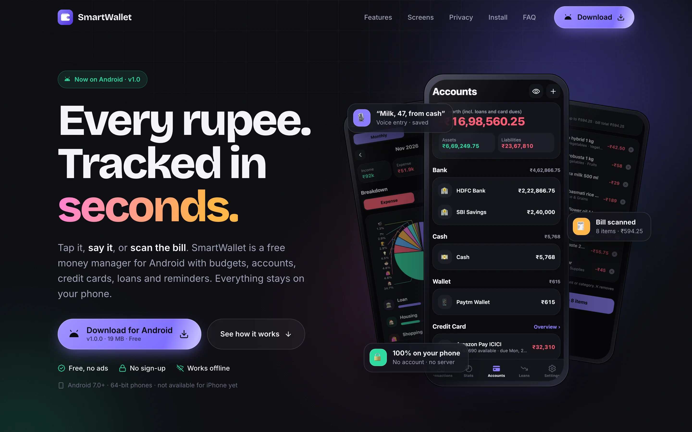
</p>

<p>
  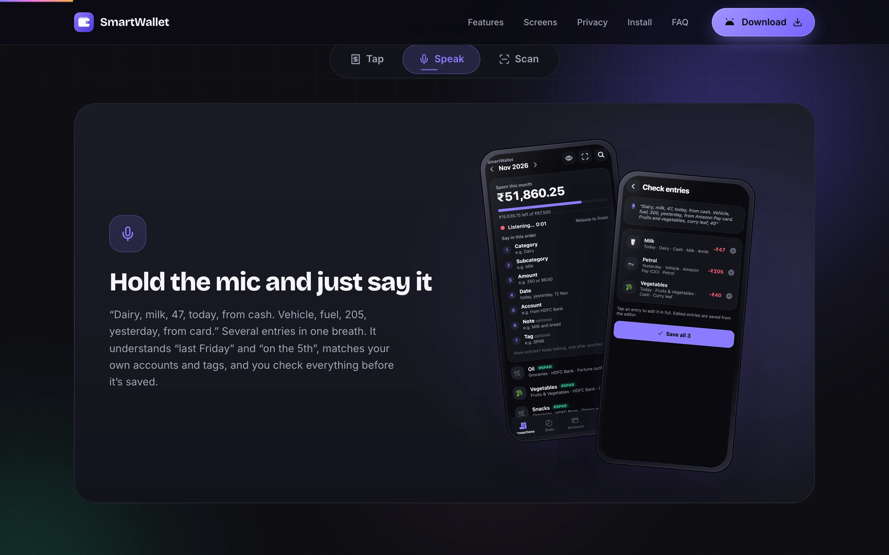
  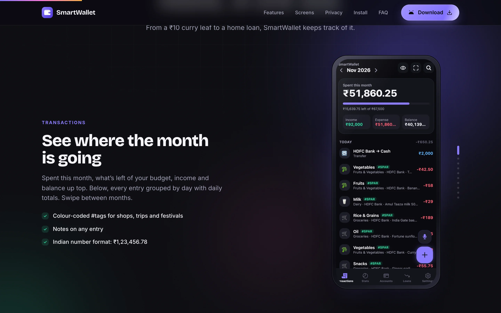
  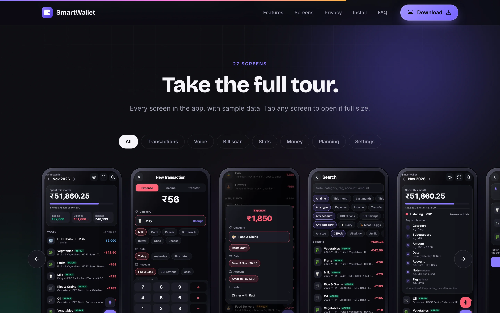
  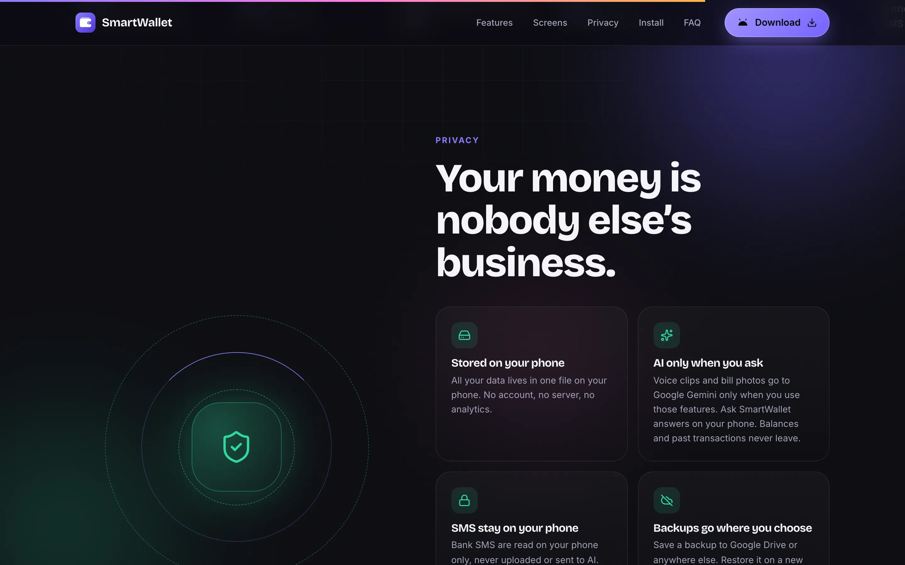
  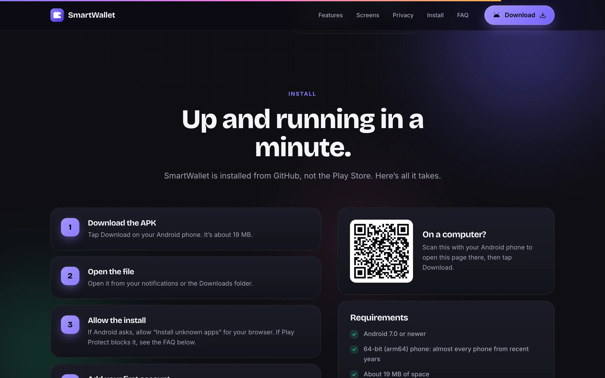
  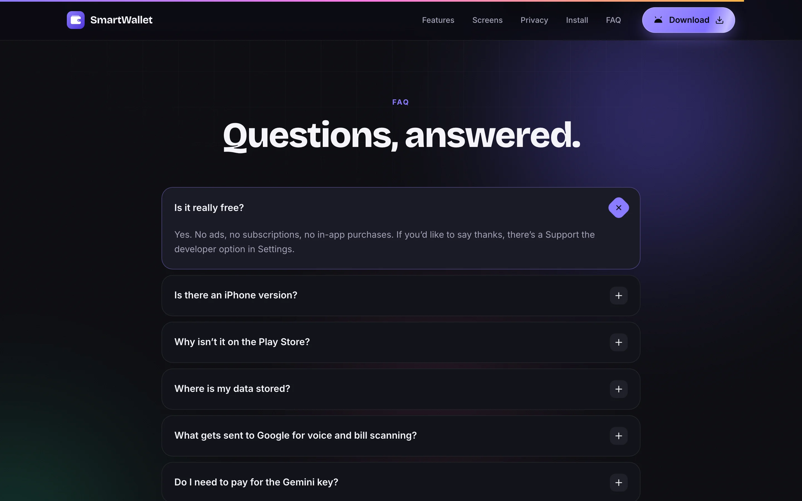
</p>

### Mobile

<p>
  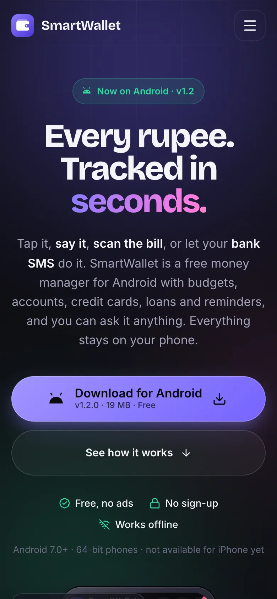
  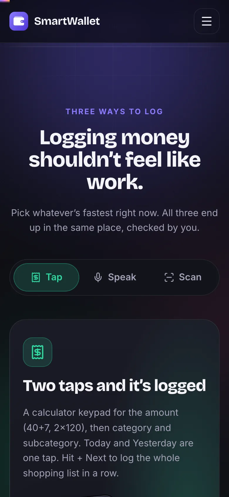
  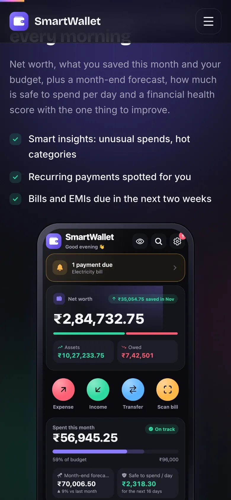
  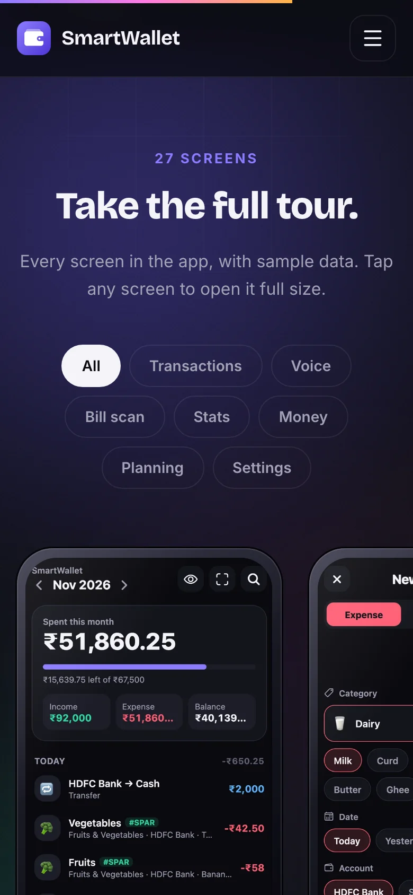
  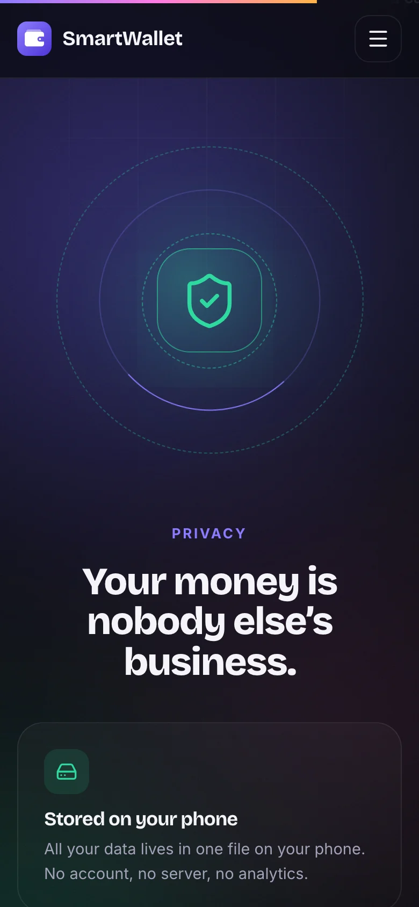
  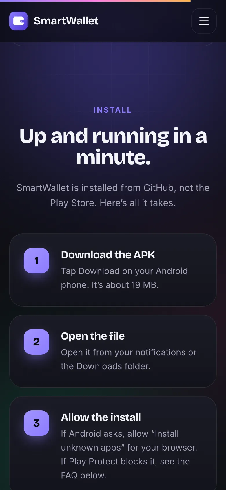
  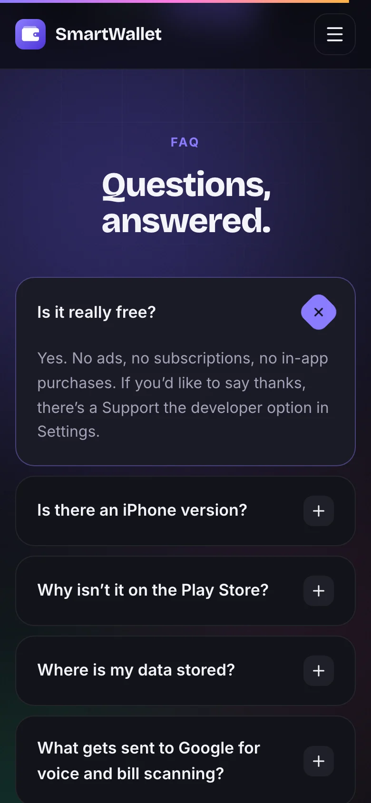
</p>

## Develop

```bash
npm install
npm run dev     # http://localhost:3000/SmartWallet-website
npm run build   # static site in out/
```

Screenshots live in `screenshots/`; `npm run assets` turns them into web images, the share card and the QR code. Pushing to `main` deploys to GitHub Pages (served under `/SmartWallet-website`). On Vercel the build detects `VERCEL` and serves from the root with no settings needed.
